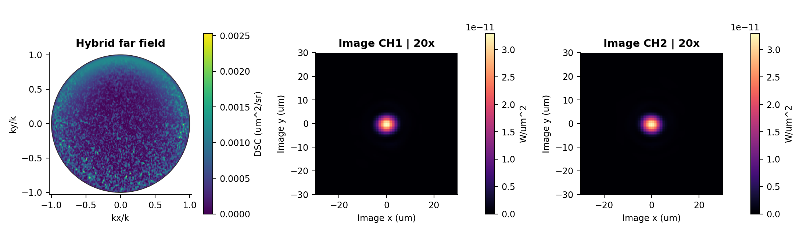
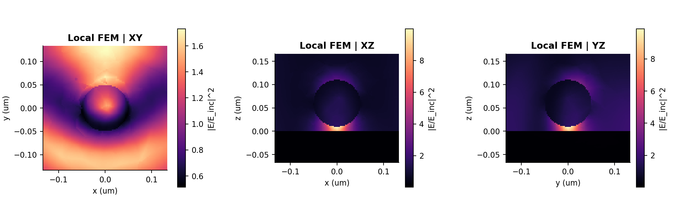
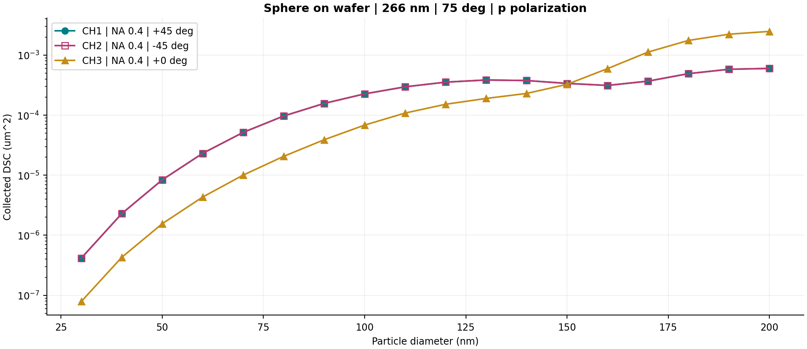
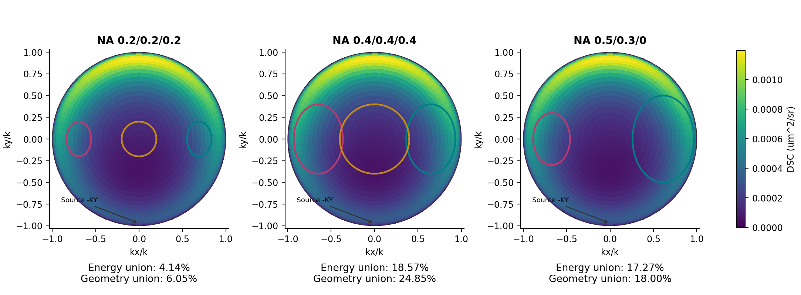
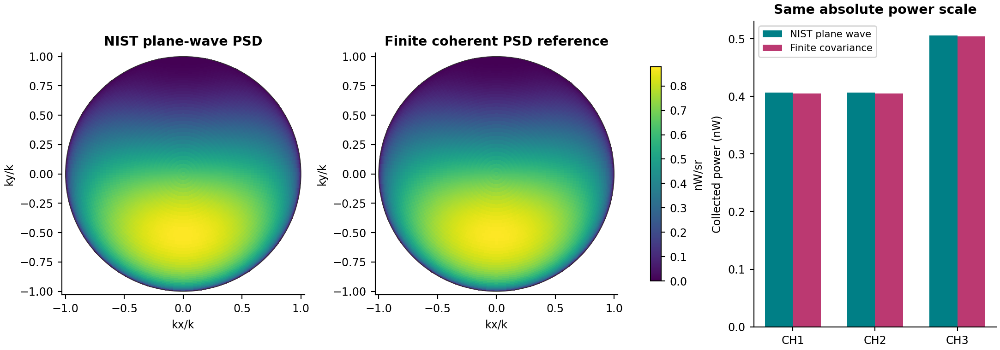
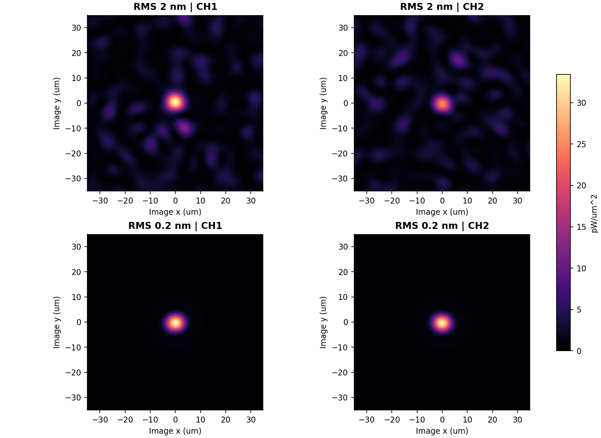
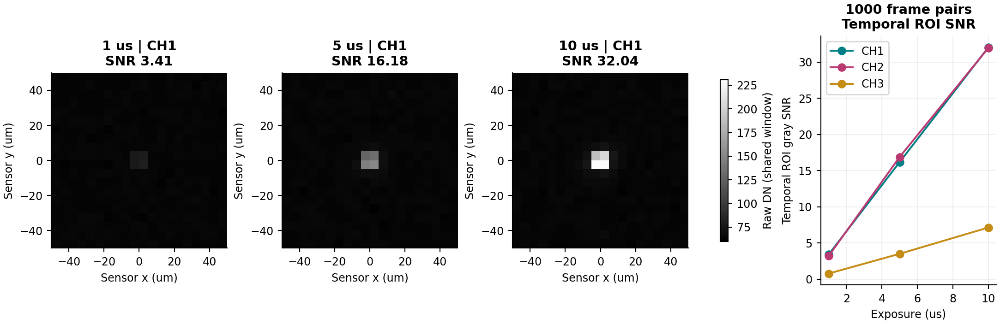
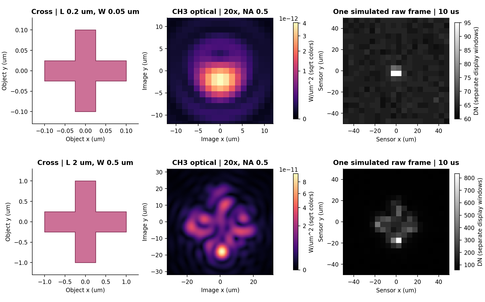

# WaferScope 暗场光学仿真软件

功能与案例手册 · 2026 年 10 月 · 当前源码功能展示

## WaferScope 暗场光学仿真软件

面向晶圆颗粒检测研发的散射分析与成像评估工具

从缺陷散射到相机灰度图

在同一套工作流中比较缺陷、照明、收光孔径和粗糙背景，连接电磁场、光学像面与相机读出。

100 nm 颗粒与低起伏粗糙背景；远场已从保存源按 401×401 方向网格重新计算，非旧强度图平滑。

|散射与材料|收光与成像|相机与可追溯结果|
|---|---|---|
|球形颗粒与多层膜 FEM 条形与十字缺陷 Gaussian 与 ABC PSD|三路独立 NA 与倾角 光锥并集去重 近场 XY XZ YZ 与独立像面|QE 与噪声及 ADC 灰度 模拟灰度帧 SNR 参数归档与数据导出|

## 查看颗粒附近的电磁场

100 nm 球形颗粒 · 266 nm · 75° p 偏振 · 颗粒底部间隙 10 nm

三个实际局部 FEM 截面。近场使用参考入射电场归一化，不是相机灰度或绝对功率。

### 观察位置

同时查看 XY、XZ、YZ 截面，定位颗粒周围的场增强、方向性和晶圆界面附近的响应。切面中的热点不能直接等同于物镜收集功率。

### 本例输入

颗粒 n=1.59、k=0；基底 n=5.57、k=0.387。Gaussian PSD RMS=0.2 nm，L=0.05 μm。材料数值为示例输入，不代表已标定的 266 nm 色散。

功能价值：先理解局部相互作用，再结合远场和像面判断可探测性。当前为数值 FEM 预览，并非任意缺陷的完备解析解。

## 连接远场角分布与独立像面

三路 NA=0.5 · 倾角 +45° −45° 0° · 20 倍 · 物镜焦距 20 mm · tube lens 400 mm

混合远场按 401×401 方向网格重评估；像面沿用同一保存源。CH1、CH2 共用绝对色标。

### 把收光方向变成可比较图像

三路分别保留自己的孔径、偏振与复场，独立传播到像面。可调整倍率、离焦、分析偏振及光路透过率，并输出光学功率。

### 保持比较口径清晰

本例 1 W，晶圆面目标高斯尺寸 X≈17.666 μm、Y≈12.492 μm，透过率 1e-4。整面 SPM 加共享局部 FEM 修正，避免局部粗糙散射重复计入。

适用边界：近场只对应局部 FEM 域；远场和像面包含整光斑一阶粗糙背景，不是整个受照晶圆的高阶全波 FEM。

## 一次比较多种粒径的三路响应

SCATMECH Bobbert–Vlieger · 30～200 nm · 步长 10 nm · 三路 NA=0.4

本次重新计算的 18 个粒径。纵轴为各孔径内积分 DSC，使用对数刻度；不是归一化峰值或相机 DN。

### 功能价值

快速建立粒径与收光响应的关系，比较侧路和中路的有效信号，为后续相机与背景预算提供光学输入。支持导出完整曲线 CSV。

### 计算条件

266 nm、75° p 偏振、平滑无膜基底；两侧 ±45°，中路 0°。n/k 同前页。该 SCATMECH 球形配置不设置 FEM 的 10 nm 间隙，不能将两者直接视为同一物理基准。

## 三路孔径独立设置并避免重叠计数

同一个 100 nm 球形颗粒远场 · 比较三组 NA · NA=0 关闭相应通道

青色 CH1，洋红 CH2，金色 CH3。轮廓是收光锥的方向投影，不是像面光斑。

|NA 组合 CH1 CH2 CH3|能量并集占比|几何并集占比|
|---|---|---|
|0.2 / 0.2 / 0.2|约 4.14%|约 6.05%|
|0.4 / 0.4 / 0.4|约 18.57%|约 24.85%|
|0.5 / 0.3 / 0|约 17.27%|约 18.00%|

能量按 DSC×立体角积分；几何按单位半球锥体积计算。两者各自对三路并集去重，不能将三路独立功率之和当作不重复总功率。表值为 4° 源角网格的示例近似。

## 将粗糙背景与 NIST PSD 参考对照

仅 haze · Gaussian RMS=0.2 nm · 相关长度 L=0.05 μm · 不含颗粒和镜面光束

NIST 平面波 PSD 与有限相干照明协方差参考；相同绝对功率标尺，不进行拟合缩放。

|仅 haze 收光功率|NIST 平面波|有限相干参考|相对 NIST 差异|
|---|---|---|---|
|CH1|0.406395 nW|0.405460 nW|-0.230%|
|CH2|0.406395 nW|0.405460 nW|-0.230%|
|CH3|0.505566 nW|0.504591 nW|-0.193%|

本例 266 nm、75° p、1 W，透过率 1e-4。有限照明尺寸同案例 01，窗口内入射功率 0.990933 W。约 0.2% 的差异不代表任意 FEM 粗糙面都达到该精度；两者均属于一阶光滑面近似。

## 区分粗糙背景与颗粒成像变化

同一表面形貌分别设置 RMS=2 nm 与 0.2 nm，低起伏情况独立重算局部 FEM

四图统一绝对色标，未逐通道或逐行归一化。

### 不只比较总能量

可分别输出颗粒增量场、haze、带符号干涉项及总光场，帮助判断亮度变化来自颗粒响应还是相干背景。

### 用统计平均检查偏置

已完成的 128 张独立 SPM 表面案例中，两侧孔径功率均值约为 40.530 和 40.551 nW；配对差的 95% 区间包含零。

### 保持统计与物理验证分开

128 张是仅 haze 的 SPM 强度平均，不是 128 次颗粒耦合 FEM。区间包含零不等于证明完全相等；更不能把单张粗糙面强制镜像对称。

统计案例为 RMS=2 nm；低 RMS 图为 0.2 nm。两类结果分别标注，不能混用同一个功率值。

## 从光学像面生成相机灰度与信噪比

100 nm 颗粒与 RMS=0.2 nm haze · Gemi 面阵近似 · 不进行 TDI 级数累加

本次新增 1、5、10 μs 三档曝光；1000 对模拟原始灰度帧。三幅 CH1 灰度图使用同一显示窗口。

|曝光|CH1 灰度 SNR|CH2 灰度 SNR|CH3 灰度 SNR|状态|
|---|---|---|---|---|
|1 μs|3.41|3.20|0.77|三路未饱和|
|5 μs|16.18|16.88|3.50|三路未饱和|
|10 μs|32.04|31.96|7.13|三路未饱和|

5 μm 像元，20×20 ROI；QE 63.9%，读噪声 12.1 e-，暗电流 1000 e-/s，满阱 16000 e-，10 bit。示例增益 16 e-/DN、偏置 64 DN 属假设，须用实测标定替换。

SNR=|样品与参考 ROI 灰度和之差的均值|/该差的时间标准差。包括信号与 haze 散粒噪声、暗噪声、读噪声、固定图样和 ADC 量化；相同静态 haze 的时间 SNR 不等于空间 haze 失配或硬件实测检出率。

## 扩展到横线竖线和十字缺陷

实际有限几何参与 FEM，不以几何图案替代衍射像；以下大十字仅展示未收敛预览能力

200 nm 与 2 μm 十字；各行光学色标及灰度窗口分别标明，不用于直接比较亮度。

### 尺寸与采样

20 倍下，200 nm 总长只对应 4 μm 像面长度；2 μm 总长对应 40 μm，约 8 个 5 μm 像元。倍率不能替代物方 NA 与采样。

### 明确的数值边界

大十字细化背景网格后，三路功率变化约 5%～15%，详细像面变化约 49%～94%。当前不能将斑驳、左右亮度差或其 SNR 作为可靠预测。

功能价值：研究形状、尺寸和方向如何进入成像链路，并用收敛检查约束结果解释。

## 选择适合问题的计算入口

从快速比较到局部场求解，再到相机评估；每个结果保留模型和输入条件

|计算入口|适合研究的问题|边界|
|---|---|---|
|SCATMECH|球形颗粒、镀膜、多层与 PSD 远场、粒径扫描|不是任意形状近场求解器|
|局部 FEM|颗粒及条形十字缺陷、局部粗糙面的近场远场|必须检查网格、计算域与 PML|
|Whole-beam SPM|受照范围内的粗糙背景与随机面强度统计|一阶近似，不含高阶颗粒耦合|
|Hybrid|整光斑 haze 与共享局部颗粒耦合修正|非整片晶圆的高阶全波解|
|相机与灰度采集|光子电子转换、噪声、饱和与时间 ROI SNR|依赖相机标定与背景参考假设|

### 在软件中复现

选择模型入口，填写材料 n/k 和照明；设置各路 NA、倾角与倍率；查看近场、远场和像面；启用相机后检查灰度、噪声、饱和与 SNR。保存参数及原始数据，再进行收敛与统计比较。

### 可交付结果

二维与三维远场、收光锥、三路独立出瞳与像面、相机 TIFF、CSV 曲线及 JSON/NPZ 参数和场数据。模型核对、独立传播检查与统计区间用于辅助判断，不替代完整实验验证。

软件仓库  github.com/wufansaber/waferscope

WaferScope 当前源码；案例沿用 2026.10.19 数据，旧版 EXE 不会自动更新。相机噪声按 EMVA 1288 相关量组织，不代表认证。

## 案例数据与复现

- 2026-10-19：案例 01 远场在同一保存混合源上加密方向求值；不是重新求解 FEM 或对旧图做平滑。
- [远场加密计算报告](assets/case01_dense_far_report.json)
- [18 点粒径扫描 CSV](particle_size_sweep.csv)
- [全部案例参数和数值](case_manifest.json)
- [相机三档曝光 SNR CSV](camera_snr.csv)
- [相机首帧及 ROI 灰度和序列 NPZ](camera_gray_examples.npz)
- 案例图由 `tools/build_showcase_cases.py` 生成，PDF 与本文件由 `tools/build_showcase_brochure.py` 生成。
- 近场与混合场源：`build/channel_symmetry_20261016/low_haze_02nm`。
- 十字源：`build/fullwave_ui/20261017_164144_979822` 及 `build/cross_2um_20261017/background_refined`。
- NIST 和统计归档：`build/channel_symmetry_20261016`。
- 数据源路径指向本机归档；分享本手册无需附带完整 FEM 原始场。重新求解还需相应运行环境与源数据。
软件仓库：https://github.com/wufansaber/waferscope
