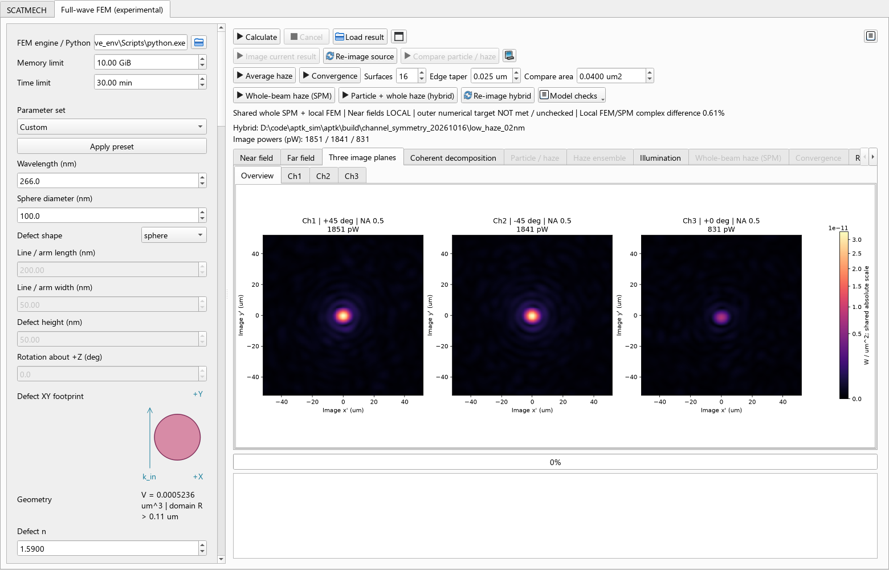
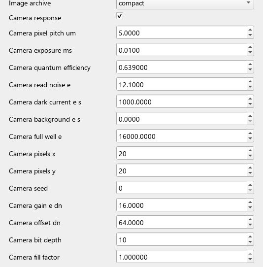
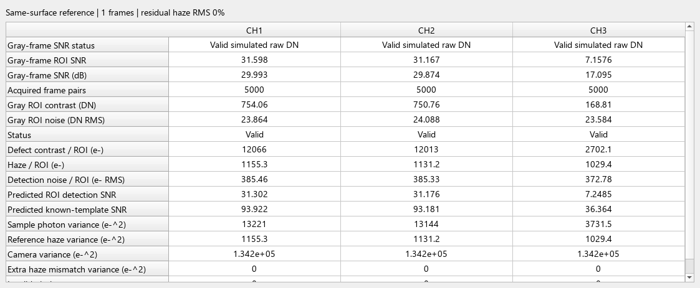
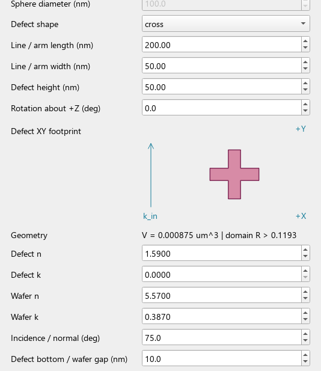

# DFI Simulation 中文操作手册

适用范围：DFI Simulation 2026.10.19 Windows x64 分文件发行版。更新日期：2026-10-19。

本手册按当前界面的英文按钮和字段名称说明操作。SCATMECH、局部 FEM、整光斑 SPM 与混合模型的结果含义不同，请先选对计算入口。FEM/混合功能仍属实验模型，不是完整晶圆的解析解。

本版更名为 DFI Simulation，包含 Gemi 面阵近似、灰度帧采集与 SNR，以及横线、竖线、十字、自动扩大缺陷物理域和大图案显示范围。旧版 EXE 不会自动更新；请以发行包 `build_manifest.json` 和随包发行说明为准。

首次使用建议先读第 2 节选择模型，再按第 17 节运行一个完整案例。只想查看结果时，用 `Load result` 打开完整结果目录，不必重新求解。只要更改了左侧参数，就须按第 12 节选择正确的计算动作；当前显示的图片不会随输入框自动重算。

## 目录

- [1. 安装与启动](#1-安装与启动)
- [2. 选择计算入口](#2-选择计算入口)
- [3. 坐标和单位](#3-坐标和单位)
- [4. 第一次运行：10 nm 颗粒](#4-第一次运行10-nm-颗粒)
- [5. 照明设置](#5-照明设置)
- [6. 粗糙面设置](#6-粗糙面设置)
- [7. 三路孔径与成像](#7-三路孔径与成像)
- [8. 整光斑 haze 和混合计算](#8-整光斑-haze-和混合计算)
- [9. 多表面平均与 NIST 对照](#9-多表面平均与-nist-对照)
- [10. 收敛与模型检查](#10-收敛与模型检查)
- [11. SCATMECH 页操作](#11-scatmech-页操作)
- [12. 结果保存和重新成像](#12-结果保存和重新成像)
- [13. 常见问题](#13-常见问题)
- [14. 正式结果检查清单](#14-正式结果检查清单)
- [15. 相机参数与原始灰度 SNR](#15-相机参数与原始灰度-snr)
- [16. 十字横线和竖线缺陷](#16-十字横线和竖线缺陷)
- [17. 常用任务逐步操作](#17-常用任务逐步操作)
- [18. 界面结果页与指标速查](#18-界面结果页与指标速查)

## 1. 安装与启动

1. 从 [GitHub Releases](https://github.com/wufansaber/aptk/releases) 选择 `v2026.10.19-dfi`，下载该版本 Windows x64 ZIP 和配套校验文件。历史相机版 `v2026.10.16-camera-snr` 使用旧名称。
2. 完整解压到本地可访问的目录，不要直接在 ZIP 内运行。
3. 双击 `DFI_Simulation.exe`。

主要文件结构如下，实际目录还包含许可、示例和验证摘要：

```text
DFI_Simulation/
  DFI_Simulation.exe
  _internal/
  fem/
    DFI_FEM.exe
    _internal/
  docs/
  verification/
  README_CN.md
  build_manifest.json
```

不要只移动一个 EXE，也不要删除任意 `_internal`。发行版附带界面和 FEM 两套运行时，无需另装 Anaconda、Python、SCATMECH 或 NGSolve。

更新手册不会自动替换以前下载的 ZIP。请完整解压本版 DFI Simulation 安装包；为兼容已有结果，用户数据目录保留原来的 `FarField_Simulation` 名称。

可用 PowerShell 核对 ZIP 的 SHA-256，与 Release 中同名 `.sha256` 文件比较：

```powershell
Get-FileHash .\你下载的发行包.zip -Algorithm SHA256
```

### 运行环境

界面建议使用至少 1280×800 的显示区域。左侧参数可滚动，也可拖动中间分隔条调整宽度；结果页右侧箭头可滚动标签，方框图标用于适配图片。结果图可用滚轮缩放、拖动平移，恢复全图时再点击适配按钮。

FEM 页默认 `Memory limit = 10 GiB`、`Time limit = 30 min`、2 个 FEM 线程。内存限制是作业预算，不代表计算机总内存；保护程序还默认保留约 3 GiB 系统可用内存，且是周期采样保护，不是操作系统硬上限。

复杂混合/收敛任务建议 32 GB RAM、足够磁盘空间，并关闭占用内存较大的应用。不能仅因计算慢就无限提高线程或放开内存限制；时间和内存需求随网格、阶数、表面范围及样本数变化。

运行中可点击 `Cancel` 请求停止，等待程序确认子进程退出。触发取消、超时或内存保护后，不要将目录内已生成的中间图片视为成功结果。

### 从源码启动（开发环境）

在项目根目录，可通过当前电脑的 NIST2 解释器直接启动界面，不依赖 PowerShell 的 conda 激活脚本：

```powershell
& 'D:\anaconda\envs\NIST2\python.exe' .\far_field_standalone\main.py
```

源码界面依赖 NIST2 中的 PyQt5/pySCATMECH，FEM 求解器使用另一个包含 NGSolve 的隔离环境，当前路径为 `build/ngsolve_env/Scripts/python.exe`。迁移电脑时需要重新配置这些环境和求解器路径；发行版 EXE 不需要这些开发环境。

不要把 `FEM engine / Python` 指向只含界面依赖的 NIST2 解释器。源码运行时应选择含 NGSolve 的隔离解释器；发行版选择 `fem/DFI_FEM.exe`。若 VS Code 的终端激活受 PowerShell 脚本策略限制，可先使用上述绝对解释器路径启动，不必为了打开软件而放开系统范围的脚本策略。

## 2. 选择计算入口

顶部有 `SCATMECH` 和 `Full-wave FEM (experimental)` 两页。FEM 页的不同按钮不是同一模型的显示选项。

| 需求 | 入口 | 计算范围与注意事项 |
| --- | --- | --- |
| 球形颗粒远场、镀膜、多层粗糙度、粒径扫描 | SCATMECH 页 | NIST 模型；不是近场 FEM |
| 颗粒与局部粗糙斑块的近场、远场、像面 | FEM 页 `Calculate`，且 `Illumination sizing=manual` | 局部 FEM 域；斑块外仍是平整晶圆 |
| 照明匹配相机视野的颗粒与整面背景 | FEM 页 `Calculate`，且 `Illumination sizing=camera` | 自动进入 hybrid；不是单纯局部 FEM |
| 平滑晶圆上的颗粒与局部纯 haze 独立对照 | `Compare particle / haze` | 先加载完整局部结果，必要时补算平滑晶圆颗粒源 |
| 多张局部随机粗糙面的 FEM 强度平均 | `Average haze` | 无颗粒；不是整光斑全局 FEM |
| 整个有限光斑覆盖粗糙面的纯 haze | `Whole-beam haze (SPM)` | 相干照明、一阶表面微扰，无颗粒 |
| 颗粒与整光斑粗糙面共同计算 | `Particle + whole haze (hybrid)` | 整面 SPM + 共享局部 FEM − 相同局部 SPM |
| 使用保存的混合复场重新成像 | `Re-image hybrid` | 不改变原始表面、颗粒或照明形状 |

如果目标是“颗粒 + 整个光斑下的粗糙背景”，应选择 hybrid，而不是认为 `Calculate` 已把局部粗糙斑块扩展到了整个照明区域。



图 1：当前源码界面加载已保存的 100 nm 低 haze 混合结果。左侧是输入，中间工具栏选择计算动作，右侧是保存的结果；图片不是按照临时编辑值自动重算。

## 3. 坐标和单位

- 晶圆名义表面为 XY 平面，+Z 指向空气，入射角相对表面法线定义。
- 光源位于 −KY 侧，入射传播方向在表面上的投影为 +KY。入射方向可写成 `(0, sinθ, −cosθ)`。
- 三路物镜轴在 XZ 平面倾斜；正倾角朝 +KX，负倾角朝 −KX，0° 沿 +Z。
- 远场二维全局坐标为 `kx/k`、`ky/k`，圆盘半径对应 `sin(散射极角)`，不是晶圆位置或像面位置。
- 同一各向同性、平滑或统计对称模型下，±X 两路可能对称；单张随机粗糙面不必逐像素对称。

| 量 | 单位/含义 |
| --- | --- |
| 波长、颗粒直径、RMS、像差 | nm |
| 光斑、局部粗糙面宽度、相关长度、像面坐标 | μm；界面写作 `um` |
| 物镜焦距 | mm |
| 激光功率 | W |
| 远场 DSC | μm²/sr；半球或孔径积分后为 μm² |
| 像面照度 | W/μm² |
| 收集或像面总功率 | W，图中可能换算为 pW/nW |
| 近场图 | 相对参考场的 `abs(E/E_inc)^2`，不是绝对功率图 |

`n` 为折射率实部，`k` 为消光系数，复折射率是 `n+ik`；这里的 `k` 不是介电常数的虚部。更改波长不会自动取得该波长的材料色散，必须填写对应的 n/k。

## 4. 第一次运行：10 nm 颗粒

### 4.1 先验证纯颗粒流程

1. 打开 FEM 页，选择 `Parameter set = 10 nm PSL preview`，点击 `Apply preset`。
2. 确认 `Defect shape=sphere`、`Sphere diameter=10 nm`。将 `Illumination sizing=manual`，再明确填写 `Wafer spot length=2 um`、`Wafer spot width=2 um`、`Laser power=1 W`。预设可能继承相机视野匹配，不能假设显示的光斑始终是 2×2 μm。
3. 首次检查将 `Roughness RMS=0 nm`，关闭 `Camera response`，以排除粗糙背景和探测器噪声；保持 `Illumination=gaussian`、`Finite beam definition=wafer_gaussian`、`Beam waist=0`。
4. 保持程序识别的 `fem/DFI_FEM.exe` 求解器路径，点击 `Calculate`。
5. 等待完成提示，查看 `Near field`、`Far field`、`Three image planes` 和 `Result parameters`。
6. 需要局部粗糙背景时，再把 RMS 改为目标值并重新 `Calculate`；需要整光斑背景时按第 8 节运行 hybrid。

| 参数 | 本节首次运行条件 |
| --- | --- |
| Wavelength | 355 nm |
| Particle n / k | 1.59 / 0 |
| Wafer n / k | 5.57 / 0.387 |
| Incidence / normal | 75°，p 偏振 |
| Sphere / wafer gap | 10 nm |
| Illumination / Finite beam definition | `gaussian` / `wafer_gaussian` |
| Laser power / wafer spot | 1 W / 2×2 μm 目标强度直径 |
| Rough surface model / RMS / PSD length | Gaussian / 0 nm / 0.05 μm；RMS=0 时关闭粗糙贡献 |
| Rough surface nodes / seed | 9 点/轴 / 7 |
| Channel 1/2/3 NA | 0.5 / 0.5 / 0.5 |
| Channel 1/2/3 tilt | +45° / −45° / 0° |
| Magnification / objective focal length | 20 / 20 mm |
| FEM profile / order / direct solver | preview / 1 / umfpack |
| Global / local mesh scale | 1.50 / 1.00 |
| Particle mesh / source quadrature | 0.00150 μm / 7 |
| Pupil samples / beam quadrature | 128 / 31 |
| Illumination sizing / Camera response | manual / 关闭 |

这是低内存预览，不是已对任意参数证明收敛的高精度配置。手动修改后预设显示 `Custom`；恢复预设会覆盖相关输入，请先记录自定义参数。

### 4.2 改为 266 nm、单路 NA=0.96

先恢复并记录预设，再设 `Wavelength = 266 nm`，填写该波长的颗粒和晶圆 n/k。将不用的两路 NA 设为 0，将保留通道 NA 设为 0.96、倾角设为所需方向，然后重新计算。

高 NA 改变收集范围和像面采样要求，应检查光瞳采样、像场大小和镜面方向遮挡。程序的散射图没有自动加入真实暗场挡光器，也不能用固定 355 nm 材料预设直接声称得到真实 266 nm 实验结果。

## 5. 照明设置

`Illumination = gaussian` 是兼容命名，当前也用于矩形/实测有限包络；实际形状由 `Finite beam definition` 决定。`plane` 是平面波，与有限 2×2 μm 光束不是同一条件。

| Finite beam definition | 长宽定义 | 操作要点 |
| --- | --- | --- |
| `wafer_gaussian` | 晶圆面目标强度 1/e² 直径；length 沿 Y、width 沿 X | 需要晶圆上的 2×2 μm 光斑时选此项 |
| `beam_cross_section` | 垂直光轴的高斯截面 1/e² 直径 | 晶圆面几何 Y 长度约为 length/cosθ，不是仍保持 2 μm |
| `wafer_rectangle` | 晶圆面的完全相干均匀矩形目标包络 | 传播谱截断后不再是严格硬边矩形 |
| `measured_wafer` | 晶圆面实测强度和可选包络相位 | 用文件选择按钮选 NPZ，检查缺失相位策略 |

四种有限模式均设 `Beam waist = 0`，不要同时填写旧的非零 waist。激光总功率独立设置，默认 1 W。

### 照明与相机视野匹配

`Illumination sizing=manual` 保留手动光斑；选择 `camera` 后，软件根据像元尺寸、ROI、倍率及各路倾角投影自动调整高斯长宽。自动状态下长宽框禁用，必须改为 manual 才能手动填写。

`Min. field / center illumination=0.5` 的含义是检查活动相机物方视野中的采样入射通量是否至少达到中心的 50%，不是均匀平顶照明，也不保证 haze 无散斑。三路斜视投影不同，不可只用一个 `ROI尺寸/倍率` 推断全部晶圆视野。

相机匹配目前用于 Gaussian/ABC 表面配合支持的高斯定义；不支持的组合会切回 manual。在 camera 状态点击 Calculate 会运行颗粒与整光斑粗糙面的混合流程。改变 ROI、倍率、NA 或倾角后，先检查自动光斑和 `Illumination > Power / coverage`；如果所需光斑变化，就必须重新求解，不能把旧场当成新照明。

有限单频照明使用相干角谱。掠入射时目标谱的一部分可能位于传播圆盘外，实际生成光斑会改变；查看 `Illumination` 中的实际分布、功率和覆盖报告。排除的标量谱权重不是激光功率损失率，传播场仍按设定总功率归一化。

### 实测光斑文件

NPZ 必须包含以下数组，示意代码只说明格式，变量应由真实测量提供：

```python
import numpy as np

np.savez("beam.npz",
         x_um=x, y_um=y,
         intensity=I,
         phase_envelope_rad=phase)
```

- `x_um`、`y_um` 是均匀递增的像素中心坐标，单位 μm，每轴 4～256 个点。
- `intensity` 形状为 `[Y, X]`，必须有限、非负且不全为零；允许相对强度，功率由 Laser power 指定。
- `phase_envelope_rad` 可省略，单位 rad，表示不含入射 +KY 载波的包络相位。
- 缺少相位时，`flat` 明确假设平坦包络相位；`reject` 拒绝运行。强度不能唯一确定相位。
- 测量范围外按零处理，不自动补出未知光斑尾部；文件改变后必须重新求解。

矩形/实测输入通常需要较高 `Beam quadrature order`，界面切换时至少设为 61。局部场积分检查不通过时逐级增加到 81、101、151，并检查报告；局部阶数通过不保证整光斑积分收敛。

## 6. 粗糙面设置

| 字段 | 含义及注意事项 |
| --- | --- |
| Rough surface model | 新计算优先用 Gaussian 或 ABC PSD；legacy 是历史高度生成器 |
| Roughness RMS | 平稳表面高度 RMS，单位 nm；局部边缘渐隐后实际 RMS 可不同 |
| PSD length B / L | Gaussian 为相关长度 L，满足 `C(r)=σ² exp[-(r/L)²]`；ABC 的 B 不是同一参数 |
| ABC exponent C | 高频衰减；必须大于 2。C≤4 时无限带宽 RMS 斜率不有限，必须关注物理高频截止 |
| Rough patch width | 局部 FEM 粗糙斑块边长，不等于光斑长宽或整面规划宽度 |
| Rough surface nodes / axis | 局部表面节点数；Gaussian 至少需要每个 L 两个网格间隔，再做加密检查 |
| Roughness seed | 固定种子便于复现；修改种子得到另一张表面，但须保持其他条件相同 |
| Edge taper | 物理边缘渐隐宽度，单位 μm；需覆盖至少一个表面网格间隔 |

RMS=0 可用于平滑晶圆颗粒检查。二维 haze 图含散斑、偏斜或局部热点，不代表网格一定不对称；统计 PSD 描述随机表面的集合，不要求每个 realization 与 NIST 平均图完全相同。

### 实测粗糙输入

在 `Rough surface model` 选择 `measured_height` 或 `measured_psd`，然后选择对应测量文件。RMS 由文件读取；仪器传递函数和高频补偿不会自动完成。

| 输入 | 必需字段或格式 |
| --- | --- |
| 高度 NPZ | 二维 `height_nm[Y,X]`，正数 `dx_um`、`dy_um` |
| 高度 CSV | 无标题二维 nm 高度矩阵；同名 JSON 提供 `dx_um`、`dy_um` |
| 二维 PSD NPZ | `fx_per_um`、`fy_per_um`、`psd_um4[Y,X]`；双边、含零频的均匀 DFT 网格，满足反演对称 |
| 径向 PSD CSV | 两列 `f_per_um,S2_um4`；频率递增、非负；不要混用一维 PSD |

PSD 频率单位是 cycles/μm，不是 rad/μm；二维 PSD 单位是 μm⁴。高度可选 `none/mean/plane` 去趋势；缺失点可选拒绝或受限的 nearest 填充。

当前 `Whole-beam haze (SPM)` 和 hybrid 支持 Gaussian/ABC PSD，不支持把实测高度或 PSD 直接作为整面输入。实测高度是一张确定性表面，不能当作多张独立样本重复计数；实测 PSD 可以用于局部 `Average haze`。

## 7. 三路孔径与成像

每一路独立设置 `Channel N NA` 和 `Channel N tilt`。NA=0 关闭该路；关闭通道后，若仍模拟相机，暗电流/读出噪声不一定为零。倾角不是 NA，也不是扫描像面的位移。

默认 NA=0.5，对空气物镜对应约 30° 光锥半角。三路默认倾角 +45°/−45°/0°，分别传播到独立像面，不相干合束。

| 参数 | 操作建议 |
| --- | --- |
| Magnification / Objective focal length | 默认 20×、20 mm，对应理想管镜焦距 400 mm |
| Pupil samples | 每轴光瞳采样；逐步增加检查三路功率和图像，不是 FEM 网格参数 |
| Image padding | 改善像面离散采样；不能替代增加 Pupil samples 来扩大物理计算像场 |
| Image defocus、Astigmatism、Coma、Spherical | 像面离焦/像差；可对保存源重新成像 |
| Power transmission | 成像功率透过率，不是额外激光功率 |
| Image archive | compact 保存重成像所需源及必要结果；full 额外保留像面复 E/H，文件更大 |
| Camera response | 启用电子数及噪声读出；需配置像素、ROI、曝光、量子效率和噪声 |

三路总功率应读取报告，不要仅依据亮度判断。FEM 三路总场像面共用绝对色标；某些分解/对照列使用不同的明确标注色标。SCATMECH 三路成像也应按各自色标和数字比较，不能把颜色相同解释为功率相同。

`Coherent decomposition` 的颗粒变化场是同一粗糙面有/无颗粒的复场差，包含耦合变化和干涉项；它不是平滑晶圆上的独立颗粒实验。`Compare particle / haze` 才是“平滑晶圆颗粒”与“保存粗糙面无颗粒”的独立对照；其功率不能相加来重建颗粒位于粗糙面上的总结果。

相机的 `Ideal SNR` 是指定噪声假设下的指标，不代表实际设备检测率。额外均匀相机背景不等同于物理 haze。注意满阱饱和、ROI 越界和实际波长处的量子效率。

相机提供 [EMVA 1288 相关噪声参数与验证](../CAMERA_MODEL_EMVA1288_CN.md)：相机增益（e-/DN）、黑电平、8～16 位 ADC、PRNU 相对 RMS、DSNU1288 固定暗偏置 RMS（e-）和可选 DCNU（e-/s）。PRNU 的 `0.01` 表示 1%，不是 0.01%。时间噪声与包含空间不均匀的总 SNR 分别输出；饱和后不能沿用线性 SNR。开启 Camera 后导出的 `camera_ch1.tiff`～`camera_ch3.tiff` 是原始灰度码，不是热力图。2026.10.16 相机发行版已包含这些相关流程，但不代表经过 EMVA 1288 认证。

## 8. 整光斑 haze 和混合计算

FEM/混合结果的 Camera 页提供 [缺陷、haze、相机噪声检测 SNR](../DETECTION_SNR_UI_CN.md)。启用 Camera response 后，以同一粗糙面的有/无颗粒像面生成相机帧并计算检测对比，不用总亮度代替缺陷信号。可设置 reference frames 及附加 haze mismatch fraction；结果含原始相机、分量图、像素 SNR 和三路指标表，饱和 ROI 显示 Invalid。默认是同一静态表面参考，不代表不同 wafer 位置的统计背景已被消除。灰度帧统计操作见第 15 节。

### 8.1 纯 haze：Whole-beam haze (SPM)

1. 设置有限照明定义、功率、波长、入射角、偏振和晶圆 n/k，保持旧 waist=0。
2. 选择 Gaussian 或 ABC PSD，设置非零 RMS、相关长度/指数、种子。
3. 设置三路 NA/倾角、倍率和光瞳采样。
4. `Surfaces` 可先设 1 作流程检查；统计分析再选固定的较大样本数。
5. 保持 `Whole-beam power coverage = 0.99`、`Whole-beam PSD variance fraction = 0.90` 作为起始规划条件，检查 Edge taper。
6. 点击 `Whole-beam haze (SPM)`。完成后查看整面高度/照明、`Mean far field`、`Mean image planes` 和 `Model / coverage / power`。

颗粒尺寸不参与此纯 haze 模式。一阶近似要求 RMS/波长足够小；程序限制 RMS/波长<0.05 不等于满足全部小斜率及数值收敛条件。

光斑 2×2 μm 不代表粗糙面规划也应是 2×2 μm。软件根据实际传播光束、照明尾部和边缘渐隐选择更大的计算窗口，读取报告中的实际宽度，不要把过去的 7.5 μm 当作固定规则。

### 8.2 颗粒 + 整面：Particle + whole haze (hybrid)

1. 在上述照明和 PSD 条件上，填写颗粒直径、n/k、间隙及局部 FEM 网格。
2. 设置 `Hybrid mother range factor`，当前界面默认 2，可选 2/4/8；旧结果可能保存为 8，应以结果报告为准。先确认内存预算。
3. 点击 `Particle + whole haze (hybrid)`，等待共享母表面、有/无颗粒局部 FEM、整面辐射和成像全部完成。
4. 检查 `Illumination`、局部 XY/XZ/YZ、远场、三路像面、相干分解以及保存参数。

混合在复振幅层面组合并减去重复局部粗糙散射。扩大母表面因子会改变新的随机实现，需要新求解局部 FEM，不能把旧 FEM 源直接拼接到新母表面。

hybrid 近场仍仅覆盖局部 FEM 域，不是整片粗糙晶圆的近场。外部粗糙面与颗粒之间的全局高阶往返耦合尚未求解；不要把这一路径称为整个光斑的全波 FEM。

## 9. 多表面平均与 NIST 对照

### 9.1 局部 FEM 平均：Average haze

1. 选择 Gaussian/ABC 或实测 PSD，RMS>0，设局部宽度、节点数和种子。
2. 若需同时显示 NIST 平面波 PSD 对照，设 `Illumination = plane`、waist=0。
3. 设置 `Surfaces`、`Edge taper` 和 `Compare area`。0.2×0.2 μm 斑块的名义面积是 0.04 μm²；比较面积不是有限激光光斑面积，也不是自动复原渐隐损失的系数。
4. 点击 `Average haze`，完成后查看 `Haze ensemble`、统计指标和有限斑块参考。

有限照明也可用于局部 FEM 平均，但该模式不会自动生成平面波 NIST 对照。不同表面平均的是强度/功率，不是复振幅。增加样本只能降低统计波动，不能消除小斑块、渐隐、网格、PSD 截断或模型误差。

### 9.2 整面 SPM 扩展到 128 张

1. 先运行或用 `Load result` 加载完整的 whole-beam haze 结果。
2. 打开 `Model checks`，选择 `Extend whole haze to 128 surfaces`。
3. 软件锁定已保存的物理输入和原规划，复用原样本并追加种子，写入新结果目录；左侧临时编辑值不会替换旧源。
4. 查看逐指标 95% 区间、同时区间和目标是否满足。已有 128 张时无需重复扩展。

128 不是所有输入都能达到 5% 精度的保证。发布版验证算例的三路同时区间半宽约为 3.24%、3.80%、3.18%，仅适用于那组 haze-only SPM 参数；不包括表面范围、FEM 或高阶耦合误差。正式统计应预先确定样本数，不因反复观察区间而提前停止。

### 9.3 SCATMECH 页的输入对齐

`Match displayed FEM haze result` 读取已完成且当前显示的局部 FEM 保存结果，不读取可能被修改的表单。用于平面波、非零 Gaussian/ABC 粗糙度、均匀晶圆条件；需要先移除 SCATMECH 镀膜。

点击后仍须在 SCATMECH 页重新运行远场。此操作不会把有限斑块 realization、有限相干光斑或 hybrid 转换成相同的无限统计 PSD 模型；不应要求两张图逐像素一致。

## 10. 收敛与模型检查

### Model checks

先加载完整 hybrid 源，才可启用相应菜单；仅有 PNG/报告的发布示例不能做需要复场的检查。

| 菜单项 | 含义 |
| --- | --- |
| Whole-surface range | 同母表面扩大外部积分范围，检查复场、功率和积分误差 |
| Same-surface grid / taper | 同一频带表面改变空间采样和渐隐；不自动增加 PSD 高频模式 |
| Low-height absolute power / energy balance | 缩小粗糙高度，比较 FEM/SPM 绝对功率及控制体内总场通量/吸收 |
| Low-height FEM / SPM (P1) | 一阶局部 FEM 的低高度极限检查 |
| Thin-limit FEM (P2, sparse) | 独立 P2 检查，可能需要更多内存 |

这些操作另存结果，不覆盖生产源。范围审计通过也不会自动将大窗口替换到原像面。

`Convergence` 用于局部 haze 的多档参数研究。对话框可填写逗号分隔的比较档位；空行表示跳过该维度。设置每工况样本数、数值容差及统计区间目标后运行，查看配对误差、功率、区间和资源状态。

**99% 入射功率覆盖率 ≠ 散射结果误差<1%；低求解残差 ≠ 物理模型正确；增加 FFT padding ≠ 表面/FEM 网格加密。** 正式结论应同时考虑表面范围与频带、FEM 网格/阶数、PML、角度积分、光瞳和统计误差。

## 11. SCATMECH 页操作

### 远场与三路物镜

1. 设置 Wafer material、晶圆 n/k；有膜层时设置 coating stack。表格第一行靠近基底，最后一行靠近空气。
2. 设置 Particle material、Sphere diameter、颗粒 n/k、激光波长、入射角和偏振。
3. 要纯颗粒时关闭 `Include roughness background`；要纯 PSD haze 时开启它并勾选 `Haze only (no particle)`。
4. 配置三路独立 NA/倾角，点击 `Run far-field simulation`。
5. 点击 `Run ideal objective example` 查看物镜光锥和出瞳；颗粒或照明参数改变后须先重新运行远场。
6. 平滑晶圆颗粒成像使用 `Calculate three image planes`；当前这一路径须关闭粗糙度，不能用它替代 FEM/hybrid haze 成像。

`Volume` 是光锥在单位上半球中覆盖的几何体积占比，`Energy` 是按实际 DSC 加权的能量占比。三路合并占比按方向掩膜并集积分，重叠只计一次；独立探测器各自的功率不能当作这个去重并集占比。

SCATMECH 颗粒+PSD 背景按非相干强度合成，不包含同一 realization 的颗粒/粗糙面相干耦合。SCATMECH 可计算膜层；当前 FEM/hybrid 的晶圆仍是均匀半空间，两页不能因输入看起来相近就直接比较多层膜结果。

### 粒径序列

设置 `Start diameter`、`End diameter`、`Diameter step`，点击 `Run particle-size sweep`。例如 30～200 nm、步长 10 nm，可查看三路积分 DSC 和能量占比曲线；NA=0 的通道保持关闭。

粒径扫描使用序列中的直径，不使用单个 Sphere diameter。它是 SCATMECH 扫描，不是批量 FEM/hybrid 全流程扫描。启用粗糙背景时，小颗粒曲线可能出现背景平台，应同时检查纯颗粒结果。

## 12. 结果保存和重新成像

发行版 FEM 结果自动保存在：

```text
%LOCALAPPDATA%\FarField_Simulation\results\时间戳目录
```

可把该路径粘贴到资源管理器地址栏，或按界面日志中的输出路径定位。源码运行通常保存在项目的 `build/fullwave_ui`。若设置 `FARFIELD_RESULTS_DIR`，以该环境变量指定的路径为准。

| 文件/目录 | 用途 |
| --- | --- |
| request.json、resources.json | 实际启动命令、作业内存/时间及完成状态 |
| scattering/report.json、paired_fields.npz | 局部保存源的参数和复场；NPZ 位于 scattering 目录 |
| imaging_report.json、image_fields.npz | 局部成像参数、各路总功率及像面数组 |
| near_field_xz/xy/yz.png | 局部近场；XY 位于颗粒中心高度，XZ 固定 Y=0，YZ 固定 X=0 |
| image_channel_1/2/3.png | 三路独立像面 |
| hybrid_source_report.json、hybrid_fields.npz、hybrid_report.json | 混合源、来源签名和混合成像报告 |
| whole_haze_report.json、whole_haze_fields.npz | 整面 SPM 统计、实际规划、功率和数组 |
| haze_ensemble_report.json | 局部 FEM 平均及参考比较 |
| gray_acquisition.png、gray_chN_series.csv | 灰度采集图与逐对 ROI 灰度和，N=1/2/3 |
| gray_chN_sample.tiff、gray_chN_reference.tiff | 第一组模拟样品与参考原始整数灰度 |
| gray_raw_stacks.npz | 在存档大小上限内保存的完整原始灰度堆栈 |

文件随计算模式不同，不会每个目录都包含上表全部文件。近场范围是局部求解范围；二维 PNG 没有完整三维复相位，不能代替散射源。

用 `Load result` 选择结果目录。普通完整局部结果可用 `Image current result` 或 `Re-image source`；混合结果使用 `Re-image hybrid`。whole-beam SPM 参数修改后通过原计算入口另算，不应选普通局部重成像按钮。

| 修改内容 | 后续操作 |
| --- | --- |
| 缺陷形状/长宽高/旋转/直径/n/k/间隙、晶圆材料、波长、入射角/偏振 | 重新运行相应物理求解 |
| 粗糙 PSD/RMS/相关长度/种子/测量文件、母域/局部几何 | 重新运行相应物理求解 |
| 光斑定义、长宽、实测强度/相位 | 重新求解；旧复场不是新光斑下的散射源 |
| NA、倾角、倍率、离焦、像差、透过率、相机设置 | 对支持的保存源重新成像 |
| 仅激光功率，保持照明形状及物理条件不变 | 对支持的保存源重新成像按功率缩放；不是重算材料非线性 |
| 仅改变色标或视图 | 不改变原始 DSC 和积分功率 |

只改相机曝光、QE、噪声、灰度采集对数时，优先使用电脑图标的“仅重算相机”，无需重复 Maxwell 求解。修改 NA、倾角或倍率属于光学重成像，不属于相机单独采集；若还改变照明匹配范围，须进一步重新物理求解。

`Load result` 会恢复已保存的多项参数，但加载结果的目的是查看和复用归档。再次从头求解前仍要检查全局/局部网格比例、FEM 阶数、求解器和预算；不要仅凭左侧数值看起来相近就认定复现了同一离散精度。

搬运可重算的结果时复制整个目录及其实际依赖源，尤其不要删除局部 paired_fields、混合复场或测量输入。部分报告引用原绝对路径，移机后需要保留对应依赖或重新求解；只有图像的示例可用于查看，但不能补算缺失近场。

SCATMECH 页用 `Export figures and data` 导出 PNG、NPZ 和参数；粒径扫描还导出 CSV。每个工况使用独立目录，避免覆盖同名文件。

## 13. 常见问题

| 现象 | 检查与处理 |
| --- | --- |
| 改尺寸后结果不变 | 是否只查看旧图/重成像旧源？重新物理求解，检查 Result parameters 中已保存的直径 |
| 点 Calculate 后没结果 | 查看底部日志及 resources.json；确认求解器路径、输入检查、内存和超时，未完成任务不当作有效结果 |
| Gaussian footprint/legacy waist 报错 | 有限光斑定义下 Beam waist 必须为 0，使用长宽配置光斑 |
| 高阶光束积分未通过 | 逐级提高 Beam quadrature order；检查实际 Illumination，不要忽略角谱或覆盖积分警告 |
| Gaussian 粗糙面无法运行 | 检查节点间距与 L、局部宽度是否适配 FEM 域、求解器及预算；增加节点可能显著增加内存 |
| FEM 和 NIST 图不同 | 区分单表面/集合均值、有限/无限斑块、有限光束/平面波、实际渐隐面积和绝对色标；先统一保存的输入 |
| 中路暗或像环形 | 检查向量偏振、物镜方向、色标及光瞳/FEM 收敛；不是所有颗粒像都必须为实心圆，矩形缺块仍需检查采样 |
| 小功率时图很暗 | 比较色标和总功率而非颜色；功率按线性模型缩放，不应为显示而改变物理归一化 |
| Model checks 灰色 | 先加载对应完整 hybrid 或 whole-beam 源；不同源只启用支持的动作 |
| ROI 越界 | 减小 ROI/像素尺寸或增大 Pupil samples；padding 不能替代扩大物理像场 |
| 触发资源保护/取消 | 保存日志，降低预览负载或增加合理预算，重新运行；不要把残留图片当作完成结果 |
| DLL 缺失 | 重新完整解压，检查主程序和 fem 两套 _internal，确认文件未被隔离 |
| 光斑长宽无法输入 | 检查 Illumination sizing 是否为 camera；需手动配置时先改 manual，再填写长宽 |
| Gray-frame ROI SNR 没有数值 | Camera response 是否开启；pairs 是否为 0、低于 100、或 haze mismatch 非零；检查 clipping、状态和源结果完整性 |
| 相机显示 Invalid | 检查满阱、ADC 上下限及 ROI；降低曝光/透过率后重算相机，不能直接删掉高亮像素重新宣称有效 |
| 十字仍像一个点 | 核对实际总长、物方 NA、倍率和像元积分；200 nm×20=4 μm，小于一个 5 μm 像元，倍率不是物方分辨率 |
| 缺陷超出计算域 | 新源码通常自动扩域；检查长宽高和 gap，旧版不具备此修正。扩域不保证内存够或已经收敛 |
| 对称通道亮度不同 | 先统一绝对色标，区分峰值/固定区域/总功率；依次做平整面、镜像粗糙面和独立随机面统计检查 |

## 14. 正式结果检查清单

1. 记录软件版本、计算入口和完整参数，保存原始测量文件与标定单位。
2. 确认波长处的材料 n/k、光斑定义、入射方向、功率、三路 NA/倾角和单位。
3. 先做纯颗粒/纯 haze 检查，区分独立实验、相干变化场和总场。
4. 确认资源报告完成，核对 warnings、生产窗口、表面频带及局部近场范围。
5. 独立检查 FEM/PML、表面范围/网格/渐隐、角度积分和光瞳采样，不能只看残差。
6. 统计分析预先确定样本数，报告逐指标及同时区间；不把统计区间当成全部模型误差。
7. 从保存报告读取绝对功率；DSC 不能直接乘激光总功率来得到 W，应使用对应参考辐照度和程序归一化。
8. 保存可复用复场及依赖源。高阶全局耦合、多层 FEM、镜面泄漏和未知测量相位等未建模因素须注明。

更多说明：[模型实现与本次校验](../fullwave_prototype/ROUGHNESS_CAMPAIGN_CN.md)、[混合模型](../fullwave_prototype/HYBRID_MODEL_CN.md)、[整光斑 haze](../fullwave_prototype/WHOLE_BEAM_HAZE_CN.md)、[原有详细指南](USER_GUIDE_CN.md)。仓库内这些链接相对有效；单独下载本手册时，可在 GitHub 同目录查看对应文件。

## 15. 相机参数与原始灰度 SNR

FEM 页的 `Parameter set` 增加 `266 nm low-haze camera`：100 nm PSL、266 nm、RMS=0.2 nm、L=0.05 μm、三路 NA=0.5、20 倍、1 W，透过率 0.0001，Gemi 面阵近似 10 μs 曝光、20×20 个 5 μm 像元。光斑采用相机视野匹配，不是沿用旧 2×2 μm 光斑。

相机预设也可用 `Apply Gemi area parameters` 单独应用，不会修改材料、波长、照明或光路透过率。QE=0.639 仅有 266 nm 的手册依据；使用此预设时其他波长会提示改为自定义 QE。手动改动探测器参数后标为 custom。

### 15.1 参数单位与来源

| UI 字段 | Gemi 面阵近似输入 | 使用注意 |
| --- | --- | --- |
| Camera pixel pitch um | 5 μm | 与倍率共同决定物方采样 |
| Camera pixels x / y | 20 / 20 | 是模拟 ROI，不是声称相机整幅只有 20×20 |
| Camera exposure ms | 0.01 ms | 等于 10 μs；1 μs 应填 0.001 ms |
| Camera quantum efficiency | 0.639 | 填比例，不填 63.9；只用于相应波长 |
| Camera read noise e | 12.1 e- RMS | 面阵近似假设；须核实是否已含量化噪声 |
| Camera dark current e s | 1000 e-/s | 当前假设，不是从 QE 推算出的暗电流 |
| Camera full well e | 16000 e- | 满阱和 ADC 上限是两种不同限制 |
| Camera gain e dn | 16 e-/DN | 未标定假设；若仪器给 DN/e-，取倒数 |
| Camera offset dn / bit depth | 64 DN / 10 | 有效灰度 0～1023，含黑电平占用 |
| Camera prnu fraction | 0.00124 | 相对 RMS，即 0.124%，固定于像元 |
| Camera dsnu e | 5.6 e- | 固定暗偏置空间 RMS，不是 e-/s |
| Camera dark current std e s | 0 e-/s | 可选暗电流空间变化；与 DSNU 区分 |
| Camera fill factor | 1 | 若有效 QE 已含填充率，不要重复扣除 |
| Camera background e s | 0 e-/s | 附加均匀电子背景，不代替物理 haze |
| Camera reference frames | 1 | 每对样品的无缺陷参考曝光数，不是 TDI |
| Camera haze mismatch fraction | 0 | 同一静态表面；非零只进入预测失配预算 |
| Gray frame pairs (0=off) | 5000 | 0 关闭；启用范围 100～20000 |

预设使用了相机手册给出的边界或典型值，也包含未标定的假设。尤其不能把 read noise、QE、gain 等不同量相互推算，或将 266 nm QE 无条件用于其他波长。

按面阵单次曝光模拟，绝不乘 TDI 级数。16 e-/DN 转换增益与黑电平 64 DN 是暂估输入，手册边界值不等于实测标定，Area 模式图像质量也未获手册保证。详见相机预设提示和保存报告。

`Gray frame pairs (0=off)` 设为 100～20000，预设为 5000。完成后在 `Camera > Detection metrics` 读取 `Gray-frame ROI SNR`，在 `Gray SNR acquisition` 查看参与统计的第一组样本/参考灰度图。原有两项预测 SNR 明确标为 Predicted，不作为灰度测得值。

```text
D_n = sum_ROI(sample_DN_n - mean_reference_DN_n)
SNR = abs(mean(D_n)) / std(D_n, ddof=1)
```

样本和无缺陷参考使用同一静态粗糙面、独立相机噪声。参考帧先逐帧 ADC 再平均；参考多帧不能当成 TDI 增益。计入颗粒/haze 相干作用后的强度及两帧散粒噪声、暗电流、读噪声、固定像素响应和实际 ADC 量化。它是模拟灰度的时间 SNR，不是实拍测量、单图空间对比度或检出概率。

若 `haze-mismatch-fraction` 非零，灰度采样不输出虚假的“已包含空间失配”SNR，会提示设为 0；理论预测仍保留失配预算。满阱或 ADC 截断时灰度 SNR 标记无效，应降低曝光或透过率后重算。

输出 `gray_chN_series.csv`、`gray_chN_sample.tiff`、`gray_chN_reference.tiff` 和 `gray_acquisition.png`。TIFF 为原始 uint16 容器，不是 16 位 ADC；Gemi 预设有效范围 0～1023。小规模任务另存 `gray_raw_stacks.npz`：样本形状 [帧,Y,X]，参考形状 [帧,参考数,Y,X]。超过存档上限时只保存 ROI 灰度序列及第一组帧，并在报告明确注明。

已有完整像面结果时，点击成像工具栏的电脑图标，仅重新模拟相机。此操作不采用当前颗粒、粗糙度、照明或 NA 控件的新值；这些物理量仍来自原图。修改 RMS 要重新物理求解。扩大相机 ROI 超过旧光斑或 FFT 视野时，也需要新的相应物理/成像计算。

顶部文档图标可加载保存的 NIST/对称性报告目录。发布包内选 `verification/camera_20261016`；这是带保存参数的校验结果，不是依据当前 UI 参数刚计算的结果。完整验证和剩余数值误差见 `CHANNEL_SYMMETRY_VALIDATION_CN.md`。

### 15.2 从已保存像面重新采集灰度

1. 点击 `Load result`，选择包含 `imaging_report.json` 和 `image_fields.npz` 的完整光学结果目录。确认加载成功及电脑图标可用。
2. 开启 `Camera response`。相同光学条件下，只改变曝光、相机参数和灰度对数；不要指望当前 NA 或颗粒参数被此动作采用。
3. 选择相机参数来源或点击 `Apply Gemi area parameters`。如果随后要用自定义曝光，再修改 `Camera exposure ms`；显示 custom 只是表示不再完全等于预设。
4. 设置 `Gray frame pairs`，建议先 100 对检查流程，再预先确定 1000 或 5000 对作统计。设 `Camera haze mismatch fraction=0`。
5. 点击电脑图标，悬停提示为 `Acquire camera / gray-frame SNR from loaded image`。等待作业完成。
6. 打开 `Camera > Detection metrics`，读取 `Gray-frame ROI SNR` 及有效性；在 `Gray SNR acquisition` 查看样品、参考和参与统计的说明。
7. 从新的结果目录导出 TIFF 与 CSV。增大帧对数只降低 SNR 估计的不确定性，不等于将多帧合成后获得同样倍数的单帧增益。



图 2：当前源码的相机参数区域。电脑图标仅重算相机，左侧的颗粒或孔径新值不会在该动作中生效。



图 3：加载已保存的 Gemi 面阵近似结果后的结果表；图中数值来自归档，不是新输入下的即时计算。

### 15.3 如何报告 SNR

记录波长、缺陷、haze、照明、三路 NA/倾角、透过率、ROI、曝光、参考帧数、增益、黑电平、ADC、随机种子和灰度帧对数。报告灰度 SNR 时同时标注 Valid/Invalid，不把 Predicted ROI/Template SNR 当作灰度帧测得值。

同一静态粗糙面参考相减会保留 haze 的散粒噪声，但不代表真实扫描到另一位置的空间背景已消失。需要实验检出率时，还必须检查背景失配、设备漂移、采样策略及误报率；本软件没有用一项 SNR 自动给出这些结论。

## 16. 十字横线和竖线缺陷

FEM 页 `Defect shape` 可选 `cross`、`line_x`、`line_y`。它们是有限尺寸的凸起实体，可设置臂/线总长度、线宽、高度和绕 Z 旋转角；XY 预览的横线沿全局 X，竖线沿全局 Y。球体直径仅在 `sphere` 下生效，材料由 Defect n/k 设置。

修改几何后必须重新 Calculate，不能只重成像或重算相机。详细定义、求解区域要求及锐边收敛限制见 [图案缺陷](../fullwave_prototype/DEFECT_PATTERNS_CN.md)。SCATMECH 球体页不支持这些非球体图案。

### 16.1 运行图案预设

1. 使用包含图案功能的当前源码，在 FEM 页选择 `266 nm cross preview`、`266 nm line X preview` 或 `266 nm line Y preview`，点击 `Apply preset`。
2. 确认 `Defect shape`、`Line / arm length`、`Line / arm width`、`Defect height`、`Rotation about +Z`。默认图案 L=200 nm、W=50 nm、H=50 nm、gap=10 nm；长度是每臂端到端总长，不是半臂长度。
3. 非球体时直径框禁用；材料仍由 Defect n/k 决定。图案是有限凸起实体，不是凹槽、无限划痕或周期光栅。
4. 保持预览的 `Illumination sizing=manual`、`Illumination=plane`、RMS=0、三路 NA=0.5。1 W 与 2×2 μm 在这里用于平面波参考辐照度，不是求解了有限矩形光束。
5. 检查几何栏中的体积与所需 Domain radius；点击 Calculate，完成后看近场、远场、三路像面及相机。



图 4：十字的 XY 轮廓和实际几何输入。正旋转绕 +Z 从 +X 朝 +Y，照明的传播投影仍从 -Y 朝 +Y。

### 16.2 扩大图案与计算域

要求 L≥W>0、H>0。底面在 z=gap，顶面在 z=gap+H。十字体积为 `(2*L*W-W*W)*H`，重叠只算一次。粗糙面最高点不得穿入缺陷实体，软件未实现缺陷与随机表面的贴合或嵌入。

当前 UI 在缺陷达到域边界时自动把 Domain radius 扩大到所需最小半径约 1.2 倍，向上取整；不自动提高 FEM 阶数或改变网格尺寸。已有半径足够时不缩小。扩大物理域仍可能触发自由度、内存或时间保护。

大图案的像面显示范围会适当扩大，但这只是防止裁图；近场矩形截面的四角仍必须位于物理域内，过长图案的近场截面可能不完整。不要把 PML 内场当作物理近场。

### 16.3 看不到十字时如何检查

先在 `Result parameters` 核对实际几何，再核对倍率和相机像元。200 nm×20=4 μm，仅为 0.8 个 5 μm 像元；50 nm 线宽在像面为 1 μm。有限 NA 与像素积分可能使图案看起来像点，不能仅增大倍率就认定应恢复全部形状。

2 μm 总长在 20 倍像面对应 40 μm，约 8 个 5 μm 像元，但分辨能力仍需独立检查。已有大十字预览的网格细化使三路功率变化约 5%～15%，详细像面变化约 49%～94%，尚未收敛。不能把其斑驳、左右亮度差或 SNR 当作定量结论，也不能用人工对称化代替求解校验。

## 17. 常用任务逐步操作

### 17.1 100 nm 颗粒与低 haze 相机案例

1. 选择 `266 nm low-haze camera` 并应用。确认 sphere、直径 100 nm、RMS=0.2 nm、L=0.05 μm、波长 266 nm、入射 75°、p 偏振及材料 n/k。
2. 检查三路 NA=0.5、倾角 +45/-45/0°、20 倍、物镜焦距 20 mm、透过率 0.0001。
3. 检查 `Illumination sizing=camera`、Gemi 近似 20×20 ROI、5 μm 像元和 0.01 ms 曝光。光斑由视野自动配置，不是 2×2 μm。
4. 检查求解器、10 GiB 作业预算、30 min 时限及所需可用系统内存。先用较少灰度对数检查流程，正式统计前固定对数。
5. 点击 Calculate。camera 匹配状态会进入 hybrid，耗时包含局部有/无颗粒 FEM、整光斑 SPM、成像和相机采样，不能用局部小模型的耗时预计。
6. 完成后按顺序查看 Illumination、三个近场截面、Far field、Three image planes、Camera；核对结果中的实际保存参数。

这是一组可运行的起始预设，不是已经标定的 266 nm PSL 材料，也不是所有网格误差均小于 1% 的精度保证。若只想浏览已归档结果，加载结果目录即可；不要因此宣称重新完成了一次独立 FEM。

### 17.2 只比较三路 NA

1. 先计算或加载完整物理散射源，记录原波长、缺陷、粗糙面及照明。
2. 只改三路 NA/倾角；NA=0 可关闭任何一路。不要改材料或光斑。
3. 局部完整源用 `Image current result`，混合完整源用 `Re-image hybrid`。不要点击电脑图标，因为它不采用新 NA。
4. 若采用 camera 视野匹配，检查新孔径与倾角是否要求新的照明范围；新光斑下必须重算物理场，不能直接复用。
5. 比较相同绝对单位的孔径功率、像面功率和相机 ROI 功率；去重并集收集率与独立探测器之和分别报告。

### 17.3 30～200 nm 粒径曲线

1. 进入 SCATMECH，设置波长、材料 n/k、入射和偏振；纯颗粒先关闭 roughness background。
2. 设置三路 NA、倾角。需要复现三路 0.4 NA 示例时，三路均填 0.4，倾角 +45/-45/0°。
3. `Start diameter=30 nm`、`End diameter=200 nm`、`Diameter step=10 nm`，共 18 点。
4. 点击 `Run particle-size sweep`；检查积分 DSC 和各路能量占比，导出 CSV、参数和图。

曲线不是自动批量运行 FEM、混合场和相机的结果。若需要相机灰度 SNR 随粒径的曲线，应对每个粒径求解相应光学场并采集相机，不能直接把 DSC 当 DN。

### 17.4 仅 haze 与 NIST 对照

1. 先选择是单张有限粗糙面、随机面平均，还是无限平稳 PSD。三者不可混为同一结果。
2. 使用同一波长、晶圆 n/k、入射、偏振、RMS、PSD 长度定义及面积。NIST 平面波对照应匹配平面波条件。
3. 局部 `Average haze` 看 FEM mean、Finite patch PSD 和 NIST PSD；整光斑 SPM 看各样本强度均值与置信区间。
4. 先比较绝对总功率和坐标方向，再比较角分布。统一色标，不逐图除以各自峰值。
5. 区分入射功率覆盖、PSD 频带覆盖、统计区间和离散误差；其中任何一项通过都不能替代其余检查。

### 17.5 曝光扫描与防止饱和

1. 加载同一个完整光学像面，保持材料、照明、NA 和倍率不变。
2. 设置 Camera exposure ms，例如 0.001、0.005、0.01 分别为 1、5、10 μs。每档选择相同 ROI、噪声及参考帧数。
3. 对每档使用电脑图标重新采集，分别保存输出目录；记录灰度 SNR、满阱和 ADC 有效状态。
4. 先保证不饱和再比较 SNR。单纯改变显示亮度或另存为更高位深 TIFF，不能恢复已经截断的数值。

### 17.6 导出并转移结果

1. 从底部日志定位输出目录，检查资源报告为 completed，确认无关键失败警告。
2. 保留报告、复场、原始灰度和相机设置；将说明、模型、材料来源、测量单位与数值精度一并归档。
3. 复制完整目录及其依赖源；实测高度或光束文件也要保留。只发送 PNG 适合浏览，不支持完整重成像。
4. 移机后先 Load result 核对内容，再配置本机 FEM engine。若报告依赖的旧绝对路径不存在，重新定位源或重新求解。

## 18. 界面结果页与指标速查

| 页面或指标 | 从哪里看 | 不要误解为 |
| --- | --- | --- |
| Near field > XZ / XY / YZ | 局部空间中的参考归一化电场 | 整片粗糙晶圆近场或相机 DN |
| Far field | 全局 kx/k、ky/k 角分布和收光方向 | 晶圆位置 XY 图 |
| Three image planes > Ch1/2/3 | 各路独立像面照度和功率 | 三路相干合束后的图 |
| Coherent decomposition | 颗粒变化场、haze、干涉与总场 | 相互独立、可直接加功率的三个实验 |
| Illumination > Power / coverage | 实际照明、窗口功率与覆盖 | 散射结果已经达到同百分比精度 |
| Camera > Raw camera | 模拟原始相机灰度 | 实拍相机图或无噪声光学照度 |
| Camera > Predicted pixel SNR | 指定噪声模型的像素预测 | 灰度帧统计的 ROI SNR |
| Camera > Detection metrics | 三路检测指标、灰度 SNR 和有效性 | 一个未说明参考条件的万能 SNR |
| Camera > Gray SNR acquisition | 第一组样品/参考图及统计说明 | 将全部帧合成的一张 TDI 图 |
| Result parameters | 已保存结果的输入和模型范围 | 当前表单每个临时编辑值 |
| Saved validation | 已归档的 NIST/对称性校验 | 新输入条件下的即时校验 |
| Energy collection | DSC 加权的方向能量积分比例 | 单纯几何体积比 |
| Volume collection | 单位半球中收光方向锥的体积比 | 实际散射能量比 |

无论图是否看起来平滑、对称或明亮，都应以保存参数、绝对数字、有效状态和相应收敛证据为准。宣传展示案例与本操作手册配套，但案例图不能替代每次计算的物理和数值检查。
